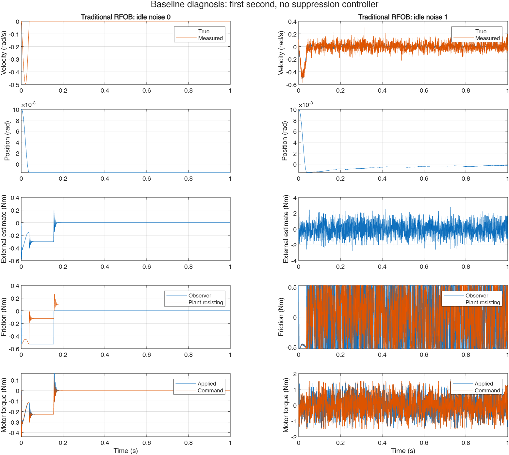
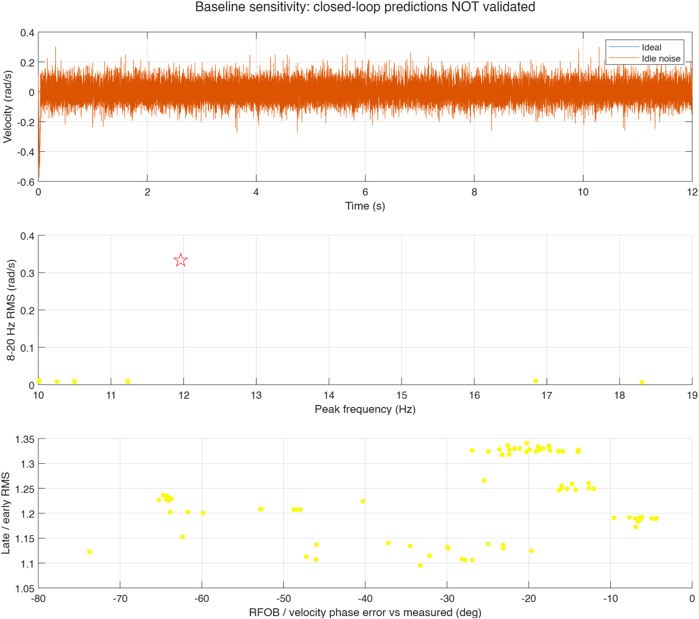

# 基準プラント診断（2026-11-02）

**実測の持続振動は未再現。制振器の閉ループ予測は未検証のままです。** 制振器の変更、12 Hzの外力注入、検証閾値の緩和は行っていません。測定ノイズと診断用の状態記録を追加しましたが、未同定のプラント定数を「改善済みの同定値」として既定値に採用していません。

実行は MATLAB で `diagnosis=run_baseline_diagnosis`、検証は `verify_baseline_diagnosis`。既存の実測解析・摩擦反事実解析・再生解析は従来どおり `rfob_oscillation_analysis` で実行します。診断結果は専用の `baseline_diagnosis/` に保存し、既存の `results/` と分離します。診断では従来RFOBのみを実行します。

## 初期0–1秒に何が起こるか

上から真値／計測角速度、位置、外部トルク推定値、推定器／プラント摩擦、実現モータトルク／指令です。プラント摩擦は各制御周期の運動量収支から求めた平均抵抗トルクで、運動方程式では差し引く符号です。最終サンプルには次の積分区間がないため摩擦記録は未評価です。

- 初期変位0.01 rad、把持剛性66.4 Nm/radにより、初期手トルクは−0.664 Nm。初期のばねエネルギーは0.00332 Jです。
- 最初の運動では最大速度約0.493 rad/sに達しますが、約0.038秒で真の速度が停止します（停止時刻の判定は |w| > 1e−6 rad/s の最終時刻）。最終位置は−0.001567 radです。
- 停止後の手トルクは+0.10405 Nmで、正方向の静止摩擦上限約0.526 Nmを下回ります。近接演算の摩擦が残留ばね力を支え、モータトルクが減衰した後も静止が維持されます。摩擦の内部弾性状態や把持の能動応答を持たないこのモデルでは、初期変位から再加速を繰り返す機構が不足しています。
- 約0.16秒に見える推定摩擦／推定トルクの変化は真の再運動ではありません。速度LPFの微小な負の残差に不連続な `sign` 摩擦が反応し、数値的にゼロに落ちるまで負の摩擦推定が残るためです。この数値尾部を持続振動と解釈してはいけません。

## 無操作時変動のモデル

122519の有効OFF区間1.000–9.916秒から、raw速度とfeedbackトルクの平均を除去し、同じ時間位置の2列を対で抽出します。元変動のRMSは約0.0671 rad/s、0.0078 Nmです。0.5秒長の移動ブロックを乱数で選ぶ方法により、ブロック内の時間相関と速度・トルクの対応を保持します。速度変動はLPFの前、トルク変動はRFOBのトルク計測に加えます。機械系への外力としては注入しません。

固定seedで再現可能で、呼出元の乱数状態を変更しません。シード17/31/53を評価しました。単一正弦波、12 Hzへのスペクトル整形、振幅の合わせ込みは行っていません。

ただし無操作ログにも実際の微小運動が含まれ得ます。これは「無操作時変動をすべて計測側に割り当てる仮説」であり、純粋なセンサ雑音の同定ではありません。ブロック境界は長時間相関を切断します。既に量子化を含むログ変動に追加量子化を重ねないよう既定の量子化幅0を維持しました。受信ジッタや非同期更新、モータ応答帯域は別途同定が必要です。

## 実測との比較

従来の共通8.916秒区間を維持して比較しました。123759の有効把持区間全体を使用すると帯域RMSは0.3382 rad/sとなり、依頼の約0.337 rad/sと整合します。共通区間による0.33316との差を埋めるための閾値変更はしていません。

| 指標 | 実測（共通区間） | 理想計測の基準 | 無操作時変動あり（seed 17） |
|---|---:|---:|---:|
| 8–20 Hz 計測速度RMS [rad/s] | 0.33316 | 0 | 0.007698 |
| 同帯域の真の運動RMS [rad/s] | 分離不能 | 0 | 0.001889 |
| 帯域内PSDピーク [Hz] | 11.9629 | 定義不能 | 10.498 |
| RFOB補償トルクの速度に対する位相 [deg] | +35.15 | 定義不能 | +16.47 |
| 後半／前半の帯域RMS | 1.1495 | 定義不能 | 1.3268 |

位相は従来と同じ、各信号のピーク周波数での正弦・余弦最小二乗による値で、正はトルクの進みです。ノイズ条件ではピークが実測と異なり、狭帯域の整った振動でもないため、位相差だけを一致の証拠にはできません。持続比が範囲内でも、持続しているのは弱い確率的変動です。無操作時変動によりRFOB推定値全体のRMSは約0.962 Nmまで増加しますが、これは12 Hzの機械振動の再現ではありません。

## 感度解析と限界

剛性30/66.4/110 Nm/rad、粘性0.01/0.05/0.2 Nm s/rad、プラント摩擦倍率0.5/1/1.5の直積を、ノイズなし1回とノイズあり3seedで評価しました（108条件）。さらにプラントのみ静止摩擦＝クーロン摩擦、Stribeck速度幅0.5倍／2倍を3seedずつ評価しました（9条件）。推定器の摩擦パラメータは固定しています。

**117条件すべて既存スクリーニング不通過**。最大の帯域RMSでも0.011011 rad/s（実測の3.31%）で、真の運動は0.004823 rad/sです。この条件は剛性110、粘性0.01、摩擦倍率0.5、seed 53であり、ピーク10.01 Hz、位相差−29.88°でした。最良モデルとして採用していません。

この範囲の把持・摩擦パラメータ変更と無操作時変動だけでは再現不足を説明できません。未評価の範囲での再現不可能性まで証明したものではありません。次の同定対象は、微小変位での摩擦内部状態／ヒステリシス、把持インピーダンスの周波数依存性、トルク応答、非同期受信です。ログの速度から逆算した12 Hz外力で不足分を埋めることは行っていません。

既存の `verify_rfob_oscillation_analysis` は通過。追加検証は固定seed再現性、乱数状態の保持、有限値、117条件の保存、実測基準値、20分割での帯域RMSの変化を確認しました。20分割では計測帯域RMS 0.00768834、真の運動RMS 0.00188357 rad/sで、どちらも10分割との差は1%未満です。ただしノイズ時の10→20分割で時系列最大速度差は約0.0303 rad/sあり、瞬間波形の厳密収束を主張しません。Code Analyzerの診断スクリプトに出る構造体未使用警告は `evalc` 内からの使用によるものです。

基準モデルが未検証のため、制振器の抑制率・閉ループ安定性・実機透明性を検証済みの結論として扱いません。
